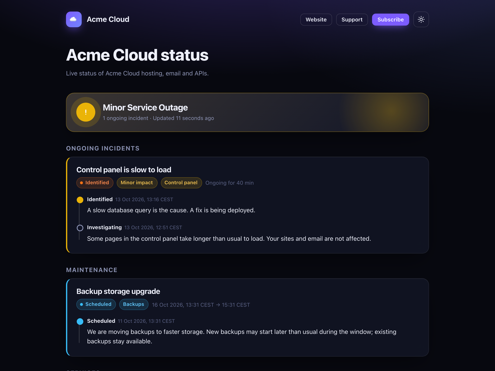
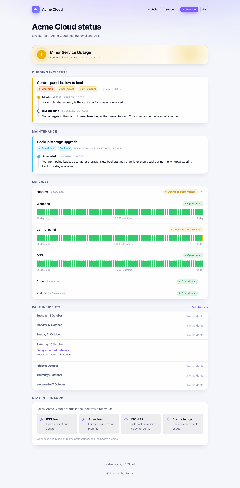
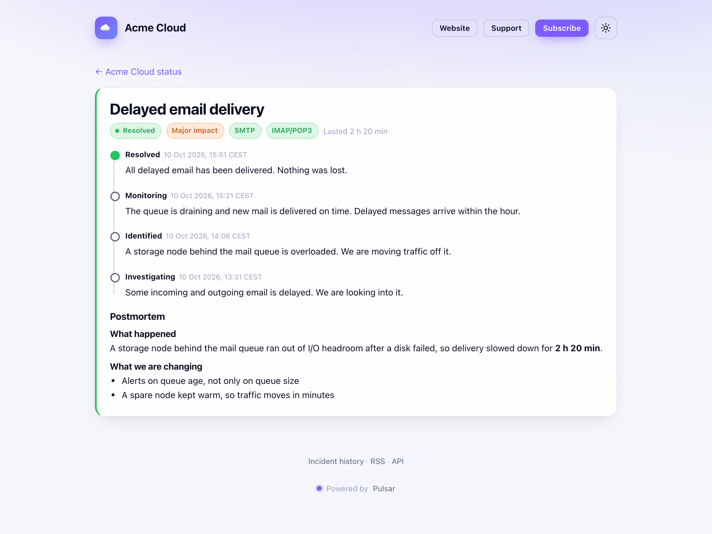
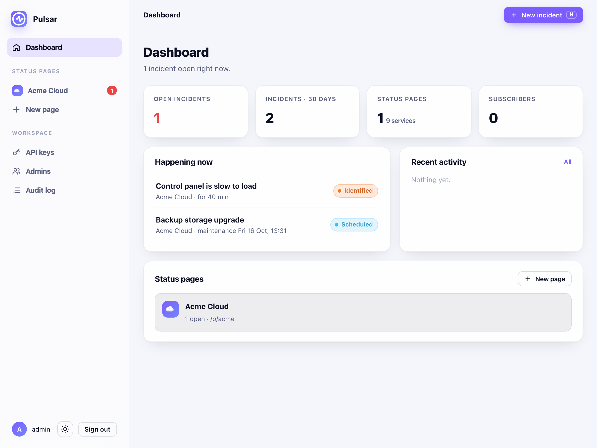
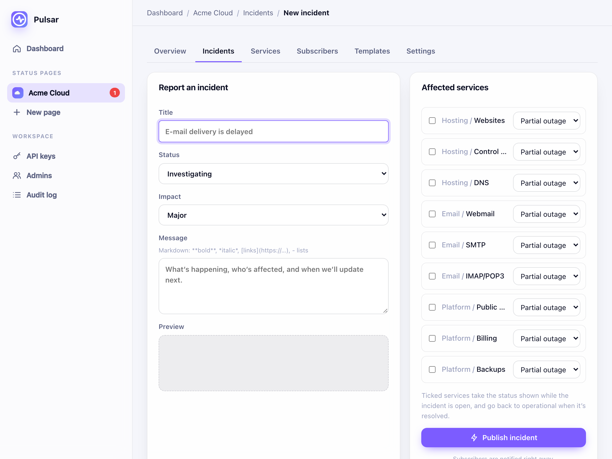

<div align="center">

# ✦ Pulsar

**Beautiful status pages that run on Cloudflare's edge, for free.**

One Worker, one D1 database, no servers. Your status page stays up even when everything else is down.



</div>

---

## Why Pulsar

- **Lives on the edge.** A single Cloudflare Worker with D1, cached at the edge. It fits the Workers free plan.
- **Speaks the format your tools already read.** Every page serves the common **v2 status-page JSON** (`summary.json`, `incidents.json`, `status.json`, `scheduled-maintenances.json`). Monitors, dashboards and chat integrations built for it work unchanged.
- **Looks like a product, not a side project.** 90-day uptime bars, grouped services, live timelines, postmortems, light and dark mode, your colour and mark.
- **Fast and private.** Server-rendered HTML, no trackers, no fonts or scripts from third parties, and a strict Content Security Policy. A small first-party script only adds niceties like the theme toggle.
- **Automation built in.** A write API with page-scoped keys, signed webhooks, Slack and Teams notifications, RSS and Atom feeds, and an embeddable badge.

## A tour

<table>
<tr>
<td width="50%"><br><sub><b>The status page.</b> Ongoing incidents, maintenance, grouped services with 90-day uptime, history and feeds.</sub></td>
<td width="50%"><br><sub><b>Every incident has its own page</b> with the full timeline and a markdown postmortem.</sub></td>
</tr>
<tr>
<td><br><sub><b>The admin app.</b> Everything happening across your pages at a glance. Press <kbd>N</kbd> for a new incident.</sub></td>
<td><br><sub><b>The composer.</b> Templates, markdown preview, and affected services that go back to operational when you resolve.</sub></td>
</tr>
</table>

## Features

| | |
|---|---|
| **Status pages** | As many as you like, each at `/p/<page>`, with its own name, description, accent colour, mark, website and support links, and time zone |
| **Own hostnames** | A page can also live at an address of its own (`status.example.com`): its page, API, history, feeds and badge served from the root there; the admin stays on Pulsar's host |
| **Services** | Grouped under headings, five states (operational → major outage, plus maintenance), 90-day uptime per service |
| **Incidents** | Investigating → identified → monitoring → resolved, with impact, affected services, a timeline of updates and a postmortem |
| **Maintenance** | Scheduled windows that start and complete on their own (a cron every 5 minutes) |
| **Templates** | Reusable titles and messages for the incidents you see again |
| **Subscribers** | Webhooks signed with HMAC-SHA256 (`X-Pulsar-Signature`), and Slack or Microsoft Teams incoming webhooks; switched off after 20 failures in a row |
| **Feeds and badge** | `/history.rss`, `/history.atom`, `/badge.svg` |
| **Read API** | `/p/<page>/api/v2/summary.json`, `incidents.json`, `status.json`, `scheduled-maintenances.json` |
| **Write API** | Bearer keys (`pls_…`), optionally limited to one page |
| **Admins** | Several admins, an audit log of every change |

## Get started

You need a Cloudflare account and Node 22+.

```sh
git clone https://github.com/edvin/pulsar && cd pulsar
npm install

# Try it locally, with a demo page
cp wrangler.example.jsonc wrangler.jsonc
npm run migrate:local
npm run demo                                   # "Acme Cloud" at /p/acme
npm run add-user -- admin --local              # prints the password once
npx wrangler dev --local-protocol https        # https://127.0.0.1:8787/p/acme and /admin
```

Deploy it:

```sh
npx wrangler d1 create pulsar                  # put the database id in wrangler.jsonc
# in wrangler.jsonc: your hostname under "routes", and PUBLIC_URL
npm run migrate
npm run deploy
npm run add-user -- admin                      # your first admin, on the deployed database
```

`wrangler.jsonc` is git-ignored, so your hostname and database id stay out of the repository.

To give a page its own hostname: add it as a custom domain on the worker (another entry under `routes` in `wrangler.jsonc`, with `"custom_domain": true`, then `npm run deploy`), and set it under the page's **Settings → Hostname**.

## The write API

Create a key under **Admin → API keys**. Then:

```sh
KEY=pls_…; P=https://status.example.com/api/v1/pages/acme

curl -s $P -H "Authorization: Bearer $KEY"                     # services (with ids) and open incidents

curl -s $P/incidents -H "Authorization: Bearer $KEY" -H 'content-type: application/json' -d '{
  "name": "Webmail is slow to load", "status": "investigating", "impact": "minor",
  "body": "We are looking into it.", "components": { "<service id>": "degraded_performance" } }'

curl -s $P/incidents/<id>/updates -H "Authorization: Bearer $KEY" -H 'content-type: application/json' \
  -d '{ "status": "resolved", "body": "Fixed." }'                # resolving puts its services back to operational

curl -s -X PATCH $P/components/<service id> -H "Authorization: Bearer $KEY" \
  -H 'content-type: application/json' -d '{ "status": "operational" }'
```

## Webhooks

Each delivery is the incident in the v2 JSON shape, plus the event (`incident.created`, `incident.updated`, `incident.resolved`, `maintenance.scheduled`, `maintenance.started`, `maintenance.completed`). It is signed:

```
X-Pulsar-Signature: t=<unix time>,v1=<hex HMAC-SHA256(secret, "<t>.<body>")>
```

The signing secret is shown once, when you add the webhook.

## Security

- **Passwords:** PBKDF2-SHA256 with a per-user salt, 25,000 iterations (the Workers free plan's CPU budget; raise it on a paid plan). Ten wrong tries from one address in 15 minutes locks that address out.
- **Sessions:** a random 256-bit cookie, stored only as its SHA-256. HttpOnly, Secure, SameSite=Strict, `Path=/admin`, 7 days. A password change signs out everywhere.
- **Changes:** every admin change is a POST that must come from Pulsar's own origin, and is written to the audit log.
- **Pages:** every value is escaped, and a strict Content Security Policy applies (`default-src 'none'`, first-party scripts only, `frame-ancestors 'none'`).
- **API keys:** stored as hashes, shown once, and optionally limited to one page.

## Development

```sh
npm run typecheck
node test/e2e.mjs --local                      # the whole flow against wrangler dev
node test/e2e.mjs https://status.example.com    # …or against a deployed Pulsar (cleans up after itself)
```

`src/index.ts` has the routing. `public.ts` has the status page, `admin.ts` the admin app, `api.ts` the write API, `core.ts` the incident logic and notifications, and `uptime.ts` the uptime bars. The schema is in `migrations/`.

---

<sub>Pulsar is not affiliated with Atlassian. "v2 status-page format" refers to the public JSON shape that many status pages serve. MIT licensed.</sub>
